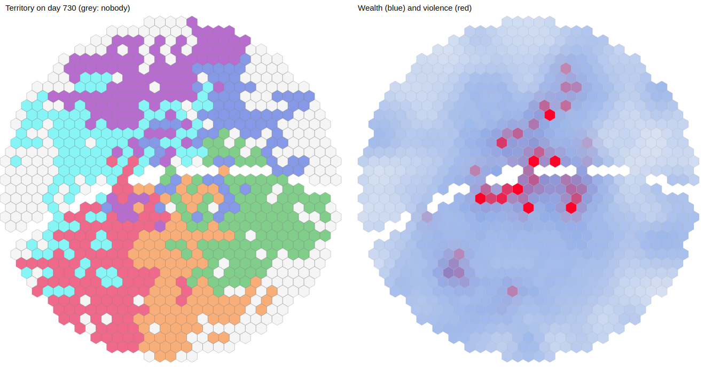

# Lilienstern

An open-source, deeply configurable grand-strategy simulation engine in Rust, in the spirit of
the engines behind map-based strategy games: a map of places, factions with an AI, a daily
clock, and every rule in data files. Its economy is written in **GlassBox**, the rule language
of SimCity (2013) with the Extended GlassBox additions for urban digital twins; its politics
(events, decisions, modifiers) in Lilienstern's own blocks, in the same files.

It is built for experiments as much as for games: every number is a parameter, runs are
deterministic, and an experiment plays a game under several parameter sets and seeds in
parallel and writes a report.

Named after Otto August Rühle von Lilienstern (1780–1847), Prussian officer, military writer
and contemporary of Clausewitz.

## Quick start

```sh
cargo build --release
./target/release/lilienstern check games/gangland
./target/release/lilienstern run games/gangland --seed 1 --geojson out/gangland.geojson
./target/release/lilienstern experiment experiments/policing.toml
```

`run` prints the course of the game every tenth of its length and a summary; `--csv` writes
the time series and `--geojson` the final map (open it in QGIS or geojson.io: neighbourhoods
are coloured by gang). `--set name=value` changes any parameter. `experiment` writes
`out/<experiment>/report.md`, `summary.csv`, one series per run and a map per variant.

## Gangland

The example game: gangs fight over a large city cut into small neighbourhoods (about 900 by
default, 10 km across, with a river and five bridges).



* **Economy** (`games/gangland/economy.gbx`, GlassBox): safehouses recruit crew in poor
  neighbourhoods; labs make product that agents carry along the streets to the gang's corners,
  which sell it; rackets extort rich neighbourhoods. All of it heats up the neighbourhood.
* **Politics** (`games/gangland/politics.lil`): gangs expand, reinforce, attack, regroup, open
  corners, rackets, labs and safehouses, hire muscle and bribe; the police patrols and raids.
  Where two gangs meet they clash, and violence drives wealth away.
* **Parameters** (`games/gangland/params.toml`): about 50 numbers, from the number of gangs to
  what police patrols go after.

Five experiments come with it (`experiments/`); see [docs/EXPERIMENTS.md](docs/EXPERIMENTS.md)
for what they ask and what they found.

## Documentation

* [docs/DESIGN.md](docs/DESIGN.md): what the engine is, how a day runs, how GlassBox fits, what
  comes next.
* [docs/SCRIPTING.md](docs/SCRIPTING.md): writing a game: `game.toml`, parameters, GlassBox
  rules, events, decisions, modifiers, the AI.
* [docs/EXPERIMENTS.md](docs/EXPERIMENTS.md): writing experiments, and Gangland's results.

## Layout

| Crate | What it is |
|---|---|
| `crates/glassbox` | The GlassBox rule language and resource-flow engine on a graph of places. No dependencies; usable on its own. |
| `crates/lilienstern` | The engine: maps (generated or GeoJSON), games, factions, scripts, the AI, control, metrics, experiments. |
| `crates/lilienstern-cli` | The `lilienstern` command. |

## License

GPL-3.0-or-later.
